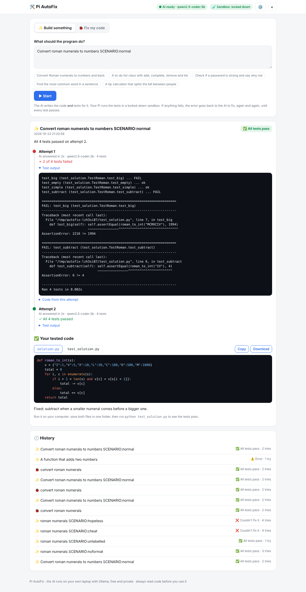

# 🛠️ Pi AutoFix

An AI coding helper that **tests its own code and keeps fixing it until every test passes**.

Describe a program (or paste buggy code), and Pi AutoFix:

1. asks a free AI model to write the code **and** unit tests for it
2. runs the tests on your Raspberry Pi in a **locked-down sandbox**
3. if any test fails, sends the exact error back to the AI to fix
4. repeats until all tests pass (up to a limit you choose)
5. gives you the tested code to copy or download, with every attempt shown along the way

It's **100% free and private**. The AI runs on your own laptop with [Ollama](https://ollama.com), with no accounts and no API keys.



```
 Your browser ──▶ Raspberry Pi (website + sandbox that runs the tests)
                       │  "write this program"  /  "here's the error, fix it"
                       ▼
                   Laptop (Ollama + free coding AI model)
```

## Features

- **✨ Build something:** describe what you want, and get working, tested Python code.
- **🐞 Fix my code:** paste buggy code (and what it should do), and get it fixed and tested.
- **Shows its work:** every attempt, the AI's time, which tests failed and the full error output.
- **Can't cheat:** if the AI tries to delete failing tests instead of fixing the code, AutoFix keeps the old tests.
- **Safe sandbox:** the AI's code runs as a separate user with **no internet**, **no access to your files**, a **20-second time limit** and a **512 MB memory limit**.
- **History** of your last 50 jobs, **light/dark mode**, works on phones.

Stage 1 supports **Python**. More languages, ESP32/Arduino hardware projects (code, wiring, parts) and 3D-printed cases are planned. See [Roadmap](#roadmap).

---

## What you need

- A **Raspberry Pi** (tested on a Pi 4 with 4GB, Raspberry Pi OS Bullseye) on your home Wi-Fi, with SSH working
- A **laptop or desktop** on the same Wi-Fi to run the AI, ideally with **16 GB RAM** (8 GB works with the small model)
- About **6 GB** of free space on the laptop for the AI models

## Part 1: Set up the AI on your laptop

### 1. Install Ollama

1. Go to **https://ollama.com/download** and download the Windows (or Mac) version.
2. Run the installer. A llama icon appears by the clock when it's running.
3. If it asks you to sign in, choose to **use it locally**. You don't need an account; signing in is only for Ollama's cloud models.

### 2. Download the coding models

Open **Command Prompt** (Windows key → type `cmd` → Enter) and run:

```
ollama pull qwen2.5-coder:3b
```

This is about **1.9 GB**. It's the fast model AutoFix uses by default.

Optional, a smarter but slower model (about 4.7 GB):

```
ollama pull qwen2.5-coder:7b
```

### 3. Check the speed

```
ollama run qwen2.5-coder:3b --verbose "Write a Python function that checks if a number is prime"
```

At the bottom, look at **eval rate**. On a laptop with Intel Iris Xe graphics and 16 GB we measured:

| Model | Speed | One answer takes about |
|---|---|---|
| `qwen2.5-coder:3b` | ~10.5 tokens/s | 30–60 seconds |
| `qwen2.5-coder:7b` | ~4.5 tokens/s | 1–2 minutes |

**Make it faster:** plug the laptop in, and set **Settings → System → Power & battery → Power mode → Best performance**. On battery, it can be 3× slower.

### 4. Let the Pi talk to Ollama

By default Ollama only accepts requests from the laptop itself.

1. Right-click the **llama icon** by the clock → **Quit Ollama**.
2. In Command Prompt run:
   ```
   setx OLLAMA_HOST 0.0.0.0
   ```
3. Start **Ollama** again from the Start menu.
4. If Windows asks about the firewall, tick **Private networks** only and click **Allow**.

This lets devices on your **home** Wi-Fi use the AI. On public Wi-Fi (school, cafés), Windows treats the network as Public and keeps it blocked.

### 5. Find the laptop's IP address

```
ipconfig
```

Under **Wireless LAN adapter Wi-Fi**, note the **IPv4 Address**, e.g. `192.168.1.150`.

> Your router may give the laptop a new address after a restart. If AutoFix suddenly says "AI offline", run `ipconfig` again and update the address in AutoFix's ⚙️ Settings.

## Part 2: Install AutoFix on the Pi

Connect to the Pi with SSH, then:

### 1. Check the Pi can reach the AI

Use your laptop's IP:

```bash
curl http://192.168.1.150:11434/api/tags
```

If it prints text containing `qwen2.5-coder`, it works. If it hangs or says "connection refused", recheck Part 1 step 4.

### 2. Download AutoFix

```bash
sudo apt install -y git
git clone https://github.com/akshajtripathi24-ui/pi-autofix.git ~/autofix
cd ~/autofix
```

AutoFix only uses Python's standard library, so there's nothing else to install.

### 3. Lock down the sandbox

```bash
bash setup-sandbox.sh
```

This:
- creates a separate user called `autofix` (no password, no login) that runs the AI's code
- lets AutoFix start programs as that user
- makes your home folder private (`chmod 700 ~`), so the AI's code can't read your files

You should see:

```
✓ Separate sandbox user works.
✓ Internet is blocked for the AI's code.
```

### 4. Make it run in the background

```bash
bash setup-autostart.sh
```

AutoFix now runs all the time and starts when the Pi boots. It uses port **8001**, so it runs fine next to Pi Stock Tracker (port 8000).

### 5. Open it and connect the AI

1. On any device on your Wi-Fi, open `http://<your-pi-ip>:8001`.
2. The ⚙️ Settings box opens. Enter your laptop's address, e.g. `192.168.1.150:11434`, pick the model, and click **Save**.
3. You should see **✓ Connected to the AI on your laptop**, and two green badges at the top: **● AI ready** and **🧪 Sandbox: locked down**.

## Using it

### ✨ Build something

1. Describe the program. Be specific: what goes in, what comes out, and any special cases.
   - 👍 "A function `is_strong(password)` that returns True if it has at least 8 characters, a number, an uppercase letter and a symbol"
   - 👎 "password thing"
2. Or click one of the example chips.
3. Click **▶ Start** and watch the attempts.

### 🐞 Fix my code

1. Paste your Python code.
2. Say what it should do. This helps the AI write the right tests.
3. Click **▶ Start**. It keeps your function names, so the fixed code still fits your project.

### Reading the results

| You see | Meaning |
|---|---|
| **AI is writing the code and tests… 0:34** | Waiting for the laptop's AI. With the 3B model, usually under a minute. |
| **✗ 2 of 4 tests failed** | Open **Test output** to see exactly what went wrong. That's what gets sent back to the AI. |
| **✓ All 4 tests passed** | Done. Your code is under **✅ Your tested code**. |
| **The AI changed the tests** | Read the tests to make sure they still check the right thing. |
| **The AI tried to remove tests** | AutoFix refused and kept the old tests. |
| **❌ Couldn't fix it** | It ran out of attempts. Describe it more clearly, raise **Max attempts**, or switch to the 7B model. |

**Use the code:** click **Download** for both `solution.py` and `test_solution.py`, put them in one folder, and run `python test_solution.py` to see the tests pass yourself.

> **Passing tests ≠ perfect.** Tests only check what they test. Always read the code and the tests before you rely on them.

### Settings (⚙️)

| Setting | Default | Meaning |
|---|---|---|
| Laptop's Ollama address | (empty) | e.g. `192.168.1.150:11434` |
| AI model | `qwen2.5-coder:3b` | Any model you've pulled on the laptop. `3b` = fast, `7b` = smarter. |
| Max attempts | 5 | How many times it may try before giving up (1–10) |

## Commands

| To do this | Run on the Pi |
|---|---|
| Update to the latest version | `cd ~/autofix && git pull && sudo systemctl restart pi-autofix` |
| Check it's running | `systemctl is-active pi-autofix` |
| See the live log | `journalctl -u pi-autofix -f` (Ctrl + C to stop watching) |
| Restart | `sudo systemctl restart pi-autofix` |
| Stop / start | `sudo systemctl stop pi-autofix` / `sudo systemctl start pi-autofix` |
| Turn off auto-start | `sudo systemctl disable --now pi-autofix` |

## How the sandbox keeps you safe

AI-written code can have bugs, or occasionally do something unexpected. AutoFix never runs it as you:

| Protection | How |
|---|---|
| **Separate user** | The tests run as the `autofix` user via `sudo`. It can't change or delete your files, and your home folder is private. |
| **No internet** | `unshare -rn` gives the code its own empty network, so it can't download or send anything. |
| **Time limit** | `timeout` kills it after 20 seconds (infinite loops, `input()` waiting forever). |
| **CPU and memory limits** | 15 seconds of CPU and 512 MB of memory, so it can't freeze the Pi |
| **Throwaway folder** | Each test run gets a fresh temporary folder that's deleted afterwards. |

We tested it with code that tries to use the internet, read a private file, delete a file, use 2 GB of memory, loop forever and call `input()`. All were blocked.

If the badge says **🧪 Sandbox: basic**, run `bash setup-sandbox.sh` and restart AutoFix.

## Troubleshooting

| Problem | Fix |
|---|---|
| **● AI offline** | Is the laptop on, awake, on the same Wi-Fi, with Ollama running (llama icon by the clock)? Did the laptop's IP change (`ipconfig`)? Did you do Part 1 step 4? |
| **● Model missing** | On the laptop run `ollama pull qwen2.5-coder:3b` (or whichever model you picked). |
| `curl` to port 11434 hangs from the Pi | Windows Firewall is blocking it, or your Wi-Fi is set to "Public". In Windows: **Settings → Network & internet → Wi-Fi → your network → Private network**. |
| It's very slow | Plug the laptop in, use **Best performance** power mode, close big apps, and use the `3b` model. The first answer after a while is slower because the model has to load (up to a minute). |
| **🧪 Sandbox: basic** | Run `cd ~/autofix && bash setup-sandbox.sh`, then `sudo systemctl restart pi-autofix`. |
| "Internet isn't blocked for tests" | Your Pi's system doesn't allow `unshare`. The other protections still work. |
| "The AI didn't follow the answer format" | Small models sometimes forget the format. AutoFix asks again automatically. If it keeps happening, try the `7b` model. |
| Tests time out | The code has an infinite loop, or calls `input()`. The AI is told about the timeout and usually fixes it. |
| `Unit pi-autofix.service not found` | Run `cd ~/autofix && bash setup-autostart.sh`. |
| The page shows an old version after updating | Press **Ctrl + F5**. |

## How it works

- **`server.py`:** a Python web server (standard library only) on port 8001. For each job it builds a prompt, calls Ollama's `/api/chat`, pulls `solution.py` and `test_solution.py` out of the answer, runs `python -m unittest` in the sandbox, and loops with the test output until everything passes. Jobs are saved in `jobs/` and settings in `config.json`; both are in `.gitignore`.
- **`index.html`:** the whole website in one file. It uses [highlight.js](https://highlightjs.org/) for code colours.
- **`setup-sandbox.sh`** creates the sandbox user; **`setup-autostart.sh`** creates the `pi-autofix` systemd service.

## Roadmap

- [x] **Stage 1:** Python, build and fix modes, test-and-fix loop, sandbox
- [ ] **Stage 2:** more languages: JavaScript, C, C++, Java, Bash
- [ ] **Stage 3:** hardware mode: ESP32/Arduino code that compiles, wiring table, parts list, wiring safety checks
- [ ] **Stage 4:** 3D-printable cases designed in OpenSCAD, rendered and checked, with a preview

## License

[MIT](LICENSE)
